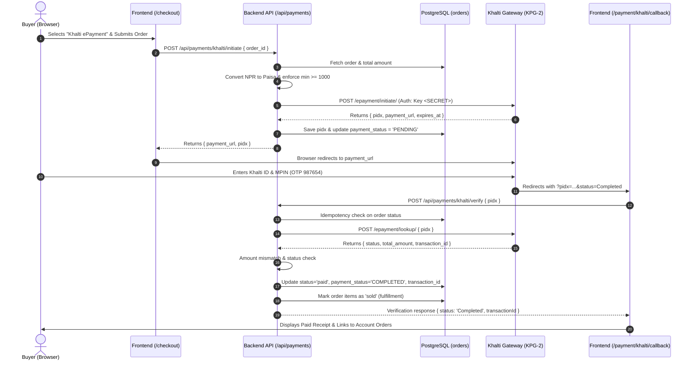

# Khalti ePayment (KPG-2) Sandbox Integration Guide

Welcome to the Khalti ePayment (KPG-2) integration documentation for **AuctionStudio**. This document provides an end-to-end guide for developers, QA engineers, and system administrators covering sandbox configuration, payment architecture, manual and automated testing, failure scenario verification, and production go-live procedures.

---

## Table of Contents
1. [Overview & Sandbox Specifications](#overview--sandbox-specifications)
2. [Prerequisites & Environment Setup](#prerequisites--environment-setup)
3. [Architecture Overview & Sequence Flow](#architecture-overview--sequence-flow)
4. [API Endpoints Reference](#api-endpoints-reference)
5. [Database Schema](#database-schema)
6. [How to Test Sandbox Payments (Walkthrough)](#how-to-test-sandbox-payments-walkthrough)
7. [Testing Failure & Edge Cases](#testing-failure--edge-cases)
8. [Historical Orders & Paid Invoices Verification](#historical-orders--paid-invoices-verification)
9. [Going Live Checklist (Sandbox to Production)](#going-live-checklist-sandbox-to-production)

---

## 1. Overview & Sandbox Specifications

Khalti ePayment Version 2 (KPG-2) provides a seamless, server-to-server payment flow where customers are redirected to the official Khalti web portal to complete payments via Khalti Wallet, ConnectIPS, Mobile Banking, or SCT Cards.

### Core Rules & Constraints
| Parameter | Sandbox Specification | Notes |
| :--- | :--- | :--- |
| **Sandbox Gateway Base URL** | `https://a.khalti.com/api/v2` | Configurable via `KHALTI_BASE_URL` |
| **Production Gateway Base URL** | `https://khalti.com/api/v2` | Used only with live merchant credentials |
| **Authentication Scheme** | `Authorization: Key <SECRET_KEY>` | Strictly prefix with `Key `, not `Bearer` |
| **Key Exposure Rule** | **Backend Only** | Secret keys must never be exposed to the client |
| **Currency & Unit** | Strictly in **Paisa** | 1 NPR = 100 Paisa (e.g. NPR 500 = `50000` paisa) |
| **Minimum Amount** | `1000` Paisa (NPR 10.00) | Amounts under 1000 paisa are strictly rejected |
| **Sandbox Merchant OTP** | `987654` | Used to log in to the test merchant portal |

---

## 2. Prerequisites & Environment Setup

### Step 1: Register on Khalti Test Merchant Portal
1. Navigate to the Khalti Test Admin Portal at [https://khalti.com](https://khalti.com) (or [https://test-admin.khalti.com](https://test-admin.khalti.com)).
2. Register an account or sign in using your merchant credentials.
3. When prompted for an SMS verification OTP, enter the static sandbox OTP: **`987654`**.
4. In the Merchant Dashboard, navigate to **Keys / API Credentials**.
5. Copy your sandbox **`live_secret_key`** (starts with `live_secret_key_` or `test_secret_key_`) and **`public_key`**.

### Step 2: Configure Environment Variables
Copy `.env.example` to `.env` in `Backend/`:
```bash
cp Backend/.env.example Backend/.env
```

Add your Khalti keys to `Backend/.env`:
```env
# ── Khalti Payment (KPG-2 ePayment Sandbox) ───────
KHALTI_SECRET_KEY=live_secret_key_YOUR_SECRET_KEY_HERE
KHALTI_PUBLIC_KEY=live_public_key_YOUR_PUBLIC_KEY_HERE
KHALTI_BASE_URL=https://a.khalti.com/api/v2
FRONTEND_URL=http://localhost:5173
```

> [!NOTE]
> If `KHALTI_SECRET_KEY` is left blank or set to `change-me`, AuctionStudio operates in **Mock Mode**, simulating gateway responses for offline development and CI environments.

---

## 3. Architecture Overview & Sequence Flow

Payment security requires that payment verification is never trusted from frontend query parameters. Verification is always executed through a server-to-server lookup from AuctionStudio Backend to Khalti KPG-2.



---

## 4. API Endpoints Reference

### 1. Initiate Payment
Initiates a new payment session with Khalti and retrieves the gateway redirect URL.

- **Route:** `POST /api/payments/khalti/initiate` (also available at `/api/v1/payments/khalti/initiate`)
- **Headers:** `Content-Type: application/json`
- **Request Body:**
  ```json
  {
    "order_id": "ORD-1774392000"
  }
  ```
- **Backend Khalti Payload sent to `https://a.khalti.com/api/v2/epayment/initiate/`:**
  ```json
  {
    "return_url": "http://localhost:5173/payment/khalti/callback",
    "website_url": "http://localhost:5173",
    "amount": 250000,
    "purchase_order_id": "ORD-1774392000",
    "purchase_order_name": "Auction Studio Order ORD-1774392000",
    "customer_info": {
      "name": "Jane Collector",
      "email": "jane@example.com",
      "phone": "+977 9800000000"
    }
  }
  ```
- **Response `200 OK`:**
  ```json
  {
    "pidx": "Htw2k63k...",
    "paymentUrl": "https://test-pay.khalti.com/?pidx=Htw2k63k...",
    "expiresAt": "2026-11-25T01:30:00Z"
  }
  ```

---

### 2. Verify Payment
Performs server-to-server transaction lookup against Khalti, validates amounts, enforces idempotency, updates order records, and fulfills line items.

- **Route:** `POST /api/payments/khalti/verify` (also available at `/api/v1/payments/khalti/verify`)
- **Headers:** `Content-Type: application/json`
- **Request Body:**
  ```json
  {
    "pidx": "Htw2k63k..."
  }
  ```
- **Backend Khalti Payload sent to `https://a.khalti.com/api/v2/epayment/lookup/`:**
  ```json
  {
    "pidx": "Htw2k63k..."
  }
  ```
- **Response `200 OK`:**
  ```json
  {
    "status": "Completed",
    "transactionId": "TXN-90291039",
    "amount": 2500,
    "orderId": "ORD-1774392000",
    "message": "Payment completed successfully"
  }
  ```

---

## 5. Database Schema

The `orders` table in PostgreSQL stores payment reconciliation and gateway state:

| Column | Type | Constraints / Default | Description |
| :--- | :--- | :--- | :--- |
| `id` | `VARCHAR(64)` | `PRIMARY KEY` | Order identifier (e.g. `ORD-1774392000`) |
| `total` | `BIGINT` | `NOT NULL` | Order total in NPR |
| `total_amount_paisa` | `BIGINT` | `DEFAULT 0` | Strict paisa amount matched against gateway |
| `payment_method` | `VARCHAR(64)` | `DEFAULT 'KHALTI'` | Payment provider identifier |
| `payment_status` | `VARCHAR(32)` | `DEFAULT 'PENDING'` | `PENDING`, `COMPLETED`, `FAILED`, `CANCELED` |
| `pidx` | `VARCHAR(255)` | `DEFAULT ''` | Khalti unique payment identifier (Indexed) |
| `transaction_id` | `VARCHAR(255)` | `DEFAULT ''` | Final Khalti transaction identifier |
| `status` | `VARCHAR(32)` | `DEFAULT 'pending'` | Order workflow status (`pending`, `paid`, `shipped`) |

---

## 6. How to Test Sandbox Payments (Walkthrough)

Follow these steps to perform a successful end-to-end sandbox payment:

1. **Start the Application:**
   ```bash
   docker compose up -d
   ```
2. **Access the Storefront:**
   Open [http://localhost:5173](http://localhost:5173) in your browser.
3. **Add Items to Cart:**
   Browse to an available lot (Buy Now or Won Auction) and add it to your cart. Ensure the subtotal is at least NPR 10.00.
4. **Proceed to Checkout:**
   Navigate to [http://localhost:5173/checkout](http://localhost:5173/checkout).
5. **Select Payment Method:**
   Under **Section 3: Payment Method**, select **Khalti ePayment (Sandbox)**.
6. **Submit Order:**
   Click **Pay via Khalti • NPR ...**.
7. **Authorize on Khalti Portal:**
   Your browser will redirect to `https://test-pay.khalti.com/?pidx=...`. Use the test credentials below:
   - **Test Khalti ID / Mobile:** `9800000000` (or `9800000001` through `9800000005`)
   - **MPIN:** `1111`
   - Click **Pay**.
   - When prompted for the verification OTP, enter: **`987654`**.
8. **Automated Return & Verification:**
   Khalti redirects back to [http://localhost:5173/payment/khalti/callback](http://localhost:5173/payment/khalti/callback). The frontend instantly submits the `pidx` to the backend confirmation API.
9. **Receipt Confirmation:**
   The page displays a green confirmation receipt showing the Order ID, Khalti Transaction ID, and Paid Status.

---

## 7. Testing Failure & Edge Cases

### A. Simulating User Cancellation
1. In the Khalti payment window, click the **Cancel** button or the close icon `✕`.
2. Khalti redirects to `/payment/khalti/callback?status=User+canceled&pidx=...`.
3. The callback page displays an amber warning banner:
   > *"Payment Canceled: You canceled the payment session on Khalti. No charges were made."*
4. The backend automatically marks the order's `payment_status` as `CANCELED`.
5. The user is provided buttons to **Return to Checkout** or **View Cart**.

### B. Simulating Invalid PIDX Lookup
1. Test verification directly via cURL with a non-existent `pidx`:
   ```bash
   curl -X POST http://localhost:8080/api/payments/khalti/verify \
     -H "Content-Type: application/json" \
     -d '{"pidx": "invalid-pidx-12345"}'
   ```
2. **Expected Response:** `400 Bad Request` with message: `"order record not found for the provided pidx"`.

### C. Simulating Amount Under Rs. 10 (1000 Paisa)
1. Attempt to initiate payment for an order total below NPR 10:
   ```bash
   curl -X POST http://localhost:8080/api/payments/khalti/initiate \
     -H "Content-Type: application/json" \
     -d '{"order_id": "ORD-LOW-VALUE"}'
   ```
2. **Expected Response:** `400 Bad Request` with message:
   `"transaction amount (... paisa) is below Khalti minimum required amount of 1000 paisa (Rs. 10)"`.

### D. Simulating Amount Tampering / Mismatch
1. If the gateway reports a `total_amount` that does not match the database `total_amount_paisa`:
2. The verification logic flags a security alert, updates the order `payment_status` to `FAILED`, rejects the transaction, and returns:
   `"security alert: payment amount mismatch! Expected ... paisa, but gateway reported ... paisa"`.

### E. Idempotency Check
1. Call `/api/payments/khalti/verify` multiple times with the same completed `pidx`.
2. Subsequent calls immediately return `Status: "Completed"` and `"message": "Payment already verified and completed (idempotent)"` without initiating secondary fulfillment or altering records.

---

## 8. Historical Orders & Paid Invoices Verification

Upon successful Khalti payment:
1. Navigate to [http://localhost:5173/account](http://localhost:5173/account) (Collector Account Dashboard).
2. Scroll to **Section 3: Historical Orders & Paid Invoices**.
3. The paid order is displayed with:
   - Order ID (e.g. `ORD-...`)
   - **PAID (KHALTI)** green badge
   - Khalti Transaction ID (`Txn: ...`)
   - Total amount paid in NPR
   - **View Receipt** button linking to the printable invoice

---

## 9. Going Live Checklist (Sandbox to Production)

Before switching from sandbox to live production:

- [ ] **Contract & Live Merchant Portal:** Sign the merchant agreement with Khalti and access [https://admin.khalti.com](https://admin.khalti.com).
- [ ] **Retrieve Live Production Keys:**
  - Copy the production `live_secret_key` and `live_public_key`.
- [ ] **Update Environment Variables:**
  ```env
  KHALTI_BASE_URL=https://khalti.com/api/v2
  KHALTI_SECRET_KEY=live_secret_key_PRODUCTION_KEY
  KHALTI_PUBLIC_KEY=live_public_key_PRODUCTION_KEY
  FRONTEND_URL=https://your-production-domain.com
  ```
- [ ] **HTTPS Enforced:** Ensure both `website_url` and `return_url` are fully qualified `https://` URLs registered in your Khalti merchant dashboard.
- [ ] **Server Firewall & Timeouts:** Whitelist outgoing requests to `https://khalti.com` with a minimum HTTP timeout of 30 seconds.
- [ ] **Security Audit:** Confirm `KHALTI_SECRET_KEY` is strictly absent from all client bundles (`Frontend/dist/`).
